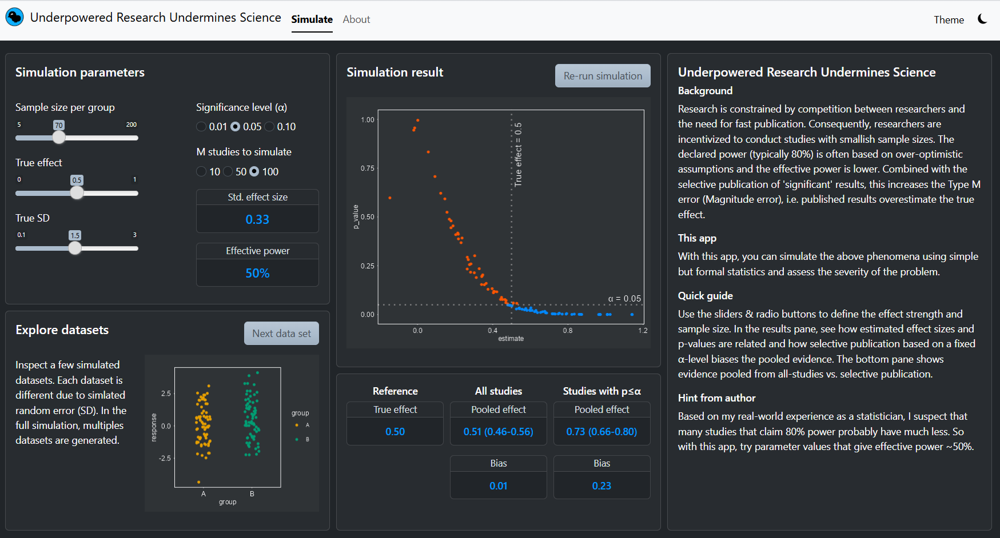

# Underpowered Research Undermines Science

### Features
This Shiny web-app offers an interactive exploration of why underpowered studies are problematic.
The bias induced by selective publishing of 'significant' underpowered studies is sometimes called the "Type-M error"



### Dependencies
- R 4.5.1
- tidyverse · shiny · bslib · metafor · thematic

### Data Source
- Simulated data, no external data needed.

### Installation
* Install R and Rstudio (and git)
* In Terminal/cmd/bash: Clone this repository
* Open this repo in Rstudio as a project (e.g. double-click **type_m_error.Rproj**)
* In R console:
  * Activate renv: ```renv::activate()```
  * Check needed R packages: ```renv::status()```
  * Install packages from renv.lock: ```renv::restore()```

### Usage - Start app (with R-studio)
Open repo in Rstudio as a project (e.g. double-click ```type_m_error.Rproj```)  
Easiest is to open app.R and then use the "Run app" button  
For more control, use Rstudio's terminal and do  
```bash
Rscript --vanilla -e "shiny::runApp(launch.browser = TRUE)"
```
More arguments can be provided, e.g.:  
```bash
Rscript --vanilla -e "shiny::runApp(launch.browser = TRUE, port = 3838, host = '127.0.0.1')"
```

### Usage - Start app (with PowerShell)

Navigate to dir containing Rscript.exe

```bash
cd <dir containing Rscript.exe>
```

Example ```cd "C:\Program Files\R\R-4.5.1\bin\"``` path many vary on each computer.

Install dependencies (skip if you already executed installation steps above)

```bash
.\Rscript -e "renv::restore(project = '.../type_m_error')"
```

Call Rscript with repo path as argument to runApp(), below replace ... by your path to repo

```bash
.\Rscript --no-init-file -e "shiny::runApp(appDir = '.../type_m_error', launch.browser = TRUE)"
```


### Project Structure

```text
type_m_error/
│
├── app.R                    # Main application entry point
├── src/                     # Shared functions, shiny ui and server components 
├── contents/                # Static items: text, pics, codebooks etc.
├── styles/                  # Style definitions, mostly CSS
│
├── renv/                    # Project-specific package environment
├── renv.lock                # Package versions and dependency snapshot
├── .Rprofile                # R startup config (used for renv activation)
│
├── sandbox/                 # misc temp code used for dev (not called by app)
├── .gitignore               # Files excluded from version control
├── didactic_stats_app.Rproj # RStudio project configuration
├── readme.md
└── LICENSE
```

### Credits
Web-app concept, analytics and implementation by Serge Zaugg ([Pollito-ML](https://github.com/sergezaugg))

### License
[MIT License - © 2026 Serge Zaugg](LICENSE)


